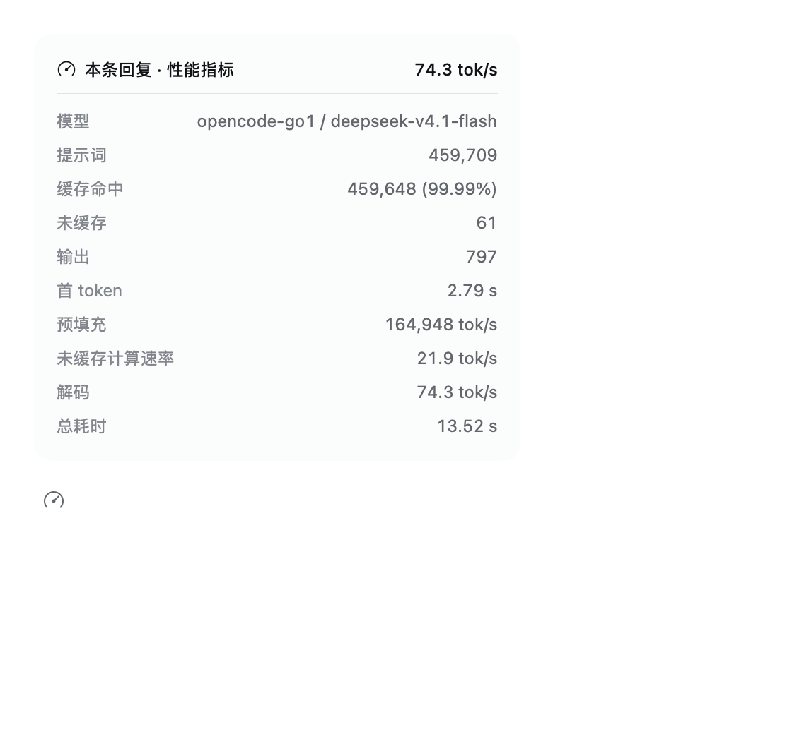

# Message metrics

A DeepSeek Harness plugin that puts a gauge action under every assistant
reply. Opening it shows that reply's performance dashboard:



| Reading | Source |
| --- | --- |
| Model | the request's provider/model route |
| Prompt | every prompt token the request took in (uncached + cached + cache write) |
| Cached | cache-read tokens and their exact share of the prompt |
| Uncached | prompt tokens the model actually computed |
| Output | completion tokens, with the reasoning share when reported |
| First token | `step/start` → first streamed delta |
| Prefill | prompt tokens / first-token time (includes cache restore) |
| Uncached compute | cache misses plus cache writes / first-token time |
| Decode | output tokens / decode time |
| Total | `step/start` → final assistant message |

The panel describes **one assistant reply**. The usage pill beside it
(`用量 … tok`) aggregates the whole turn across every step, so the two
numbers answer different questions: this panel is the request that produced
the closing answer, the pill is every request in the turn.

When almost the whole prompt is served from a provider cache, the Uncached
row is small and the prefill rate is the cache-inclusive ingestion rate; the
Uncached compute row is that small share over the same first-token window, so
it stays low even though the request returned quickly. Read Decode for model
generation speed.

Everything is derived from the durable message the Session already records
(provider usage plus the step and chunk timestamps), so the dashboard works
for every provider, local or cloud, and adds no request of its own.

The readings come from two conversation targets and are merged field by
field:

- the **Chat** target supplies the settled message and its token buckets;
- the **Trajectory** target supplies the durable first-token time (it folds
  the packed stream records back into a timestamp) and the provider/model
  route, which the Chat target does not carry.

An assembly without the Trajectory view still shows the token rows; timing
and the model row then fall back to the Chat target and may read `—`.

The trigger matches the shipped assistant action strip (28px IconActions,
15–17px gauge glyph, tertiary label colour). The panel reuses the stat-dialog
skin: menu surface, `--dsw-elevation-prominent`, the 12px detail grid, and
viewport-clamped placement above the trigger.

## Install

Add it to your DSH profile as a linked dependency and select the
`@local/dsh-message-metrics` bundle:

```json
"@local/dsh-message-metrics": "link:/absolute/path/to/dsh-message-metrics"
```

The bundle name is `@local/dsh-message-metrics`; after the next load the gauge
appears in every assistant message's action row.

## Usage

Click the gauge under a reply. The headline shows decode throughput; the rows
below list the model, token buckets, first-token latency, prefill and decode
throughput, and total request time. Escape or an outside click closes it.

## License

MIT
